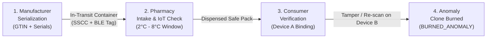

# MedVerify IoT — Decentralized Pharmaceutical Serialization & Cold Chain Track-and-Trace

[](https://opensource.org/licenses/MIT)
[](https://nodejs.org/)
[](https://vitejs.dev/)
[](https://react.dev/)
[]()

> A full-stack pharmaceutical serialization, cold-chain IoT telemetry monitoring, and cryptographic anti-counterfeit verification platform built with React, Vite, and GS1 Digital Link standards.

---

## 📌 Problem Overview
Counterfeit pharmaceuticals and temperature-compromised medicines pose life-threatening risks worldwide:
- **Counterfeit Cloning**: Unauthorized parties duplicate genuine QR codes or barcodes onto fake medicine packaging.
- **Cold-Chain Breaches**: Critical biologics (vaccines, insulin) degrade when temperature excursions (outside 2°C – 8°C) occur in transit without automated detection.
- **Lack of Patient Verification**: Patients lack a trustworthy, cryptographic tool to verify whether a medicine was already consumed, cloned, or thermally ruined.

**MedVerify IoT** solves these issues with:
1. **GS1 Digital Link Serialization**: Unique cryptographic unit serials for individual packs.
2. **ColdGuard IoT Telemetry**: Continuous environmental temperature monitoring with automated tamper-sealing.
3. **Single-Use Device Binding (SHA-256)**: Once an authentic pack is verified on a patient's device, any subsequent scan by an unauthorized secondary device triggers an immediate **Clone Alert** and permanently burns the pack status.

---

## 🧭 System Architecture & Workflow



---

## 🚀 Key Modules & Pages

### 1. 🏭 Manufacturer Serialization Control Center
- Generate serialized pharmaceutical batches with custom **GTIN**, **Batch Number**, **Quantity**, and **Expiry Date**.
- Generates **GS1 standard Digital Link QR codes** (`https://medverify.app/01/{GTIN}/21/{SERIAL}`).
- Export production bundles:
  - 📄 **CSV manifests**
  - 📑 **Printable PDF label sheets**
  - 📦 **ZIP packages** with high-resolution PNG & vector SVG QR codes.
- Live DataMatrix / QR label preview cards with customizable HTML template tags.

### 2. 🏥 Pharmacy Cold-Chain Intake Console
- Ingests **Bluetooth Low Energy (BLE)** environmental sensor tags from incoming pharmaceutical shipments.
- **ColdGuard IoT Telemetry Simulator**:
  - Live interactive gauges for Minimum Temperature, Maximum Temperature, and Excursion Duration.
  - One-click presets:
    - 🟢 **Optimal Cold Chain**: `3.2°C Min / 5.4°C Max` (Safe 2°C – 8°C window).
    - 🔥 **Heat Excursion Breach**: `4.0°C Min / 14.2°C Max` (Breach alert, 140 min excursion).
    - ❄️ **Sub-Zero Freezing**: `-2.8°C Min / 4.0°C Max` (Freezing breach alert).
  - Physical Web Bluetooth interface for hardware BLE GATT beacons.
  - Seals cryptographic records into `thermal_logs` and flags `is_compromised = true` if breached.

### 3. 🛡️ Consumer Authenticity Verification Center
- Multiple input channels:
  - 📷 **Live Camera Scanner** (HTML5 QR scanner)
  - 🖼️ **Image File Upload**
  - ⌨️ **Manual Entry**
  - ⚡ **1-Click Demo Pick** for instant testing without camera hardware.
- **Anti-Counterfeit Decision Engine**:
  - 🟢 **Authentic & Safe (First Scan)**: Binds serial to Device A's SHA-256 fingerprint; status transitions to `ACTIVATED`.
  - 🟢 **Authentic (Scanned by you)**: Re-scanned on the same registered device.
  - 🔴 **High Threat (Physical Label Clone Detected)**: Scanned on a secondary device $\to$ permanently burns status to `BURNED_ANOMALY`.
  - 🔴 **Thermal Integrity Breach Alert**: Blocks administration if cold-chain was breached in transit.
  - 🔴 **Counterfeit Serial Alert**: Flags unregistered or fabricated serial numbers.

### 4. 📊 Supply Chain Audit Ledger & Analytics
- Live KPI dashboard (Total Shipments, Total Serialized Packs, In Transit, Pharmacy Inventory, Patient Activated, Burned Clones).
- Search and filterable audit table across all units.
- **Unit Provenance Trail Modal**: Visual 4-phase chronological lifecycle tracking:
  1. Factory Serialization & GTIN Registration
  2. Master Container Packing & BLE Tag Assignment
  3. Pharmacy Intake & Cold-Chain Handshake
  4. Patient Verification & SHA-256 Device Binding.

### 5. 🧪 Interactive Automated Test Runner (UI)
- Embedded test console directly inside the application interface showing real-time test executions, assertion breakdowns, and pass/fail states.

---

## 🧪 Automated Testing Suites

MedVerify includes a comprehensive, multi-layered testing architecture:

### 1. 🔬 White Box Testing (`npm run test:whitebox`)
- Focuses on **internal logic, boundary conditions, and code branches**:
  - SHA-256 cryptographic hashing determinism and collision resistance (`hashDeviceId`).
  - Boundary Value Analysis on cold-chain limits (`2.0°C` safe vs. `1.9°C` breach, `8.0°C` safe vs. `8.1°C` breach).
  - Complete decision branch coverage across all 7 state transitions of `verifyItem()`.
  - Template tokenizer and parser error handling (`renderTemplate()`).

### 2. 📦 Black Box Testing (`npm run test:blackbox`)
- Focuses on **system specifications and end-to-end user journeys**:
  - **REQ-001**: Manufacturer batch generation & GS1 format compliance.
  - **REQ-002**: Pharmacy IoT environmental ingestion & tamper-sealing.
  - **REQ-003**: Patient verification lifecycle, clone attack prevention, and counterfeit rejection.

### 3. 🌐 Selenium WebDriver E2E Automation (`npm run test:selenium`)
- Automated browser testing verifying real DOM interactions:
  - `TC-SEL-01`: Page load, visual branding & navigation tabs.
  - `TC-SEL-02`: Client-side tab switching.
  - `TC-SEL-03`: Manufacturer batch generation & QR rendering.
  - `TC-SEL-04`: Pharmacy safe cold-chain intake.
  - `TC-SEL-05`: Thermal excursion alert detection.
  - `TC-SEL-06`: Consumer verification & device signature binding.
  - `TC-SEL-07`: Clone attack simulation on secondary device.
  - `TC-SEL-08`: Supply Chain Ledger filtering & 4-phase provenance timeline modal.

---

## 💻 Quick Start & Running Locally

### Prerequisites
- [Node.js](https://nodejs.org/) v20 or higher
- [Google Chrome](https://www.google.com/chrome/) (for Selenium E2E tests)

### Installation
```bash
# Clone the repository
git clone https://github.com/varadd777/MedVerify.git

# Navigate into project directory
cd MedVerify

# Install dependencies
npm install
```

### Running Development Server
```bash
npm run dev
```
Open **[http://localhost:5173/](http://localhost:5173/)** in your browser.

### Running Automated Test Suites
```bash
# Run White Box unit & branch tests
npm run test:whitebox

# Run Black Box functional requirements tests
npm run test:blackbox

# Run All Unit & Functional Tests
npm test

# Run Selenium WebDriver Browser E2E Tests (with dev server active)
npm run test:selenium
```

### Building for Production
```bash
npm run build
```

---

## 📂 Project Structure
```text
MedVerify/
├── src/
│   ├── components/
│   │   ├── ConsumerVerification.jsx       # Patient QR scan, clone & thermal checks
│   │   ├── ManufacturerSerialization.jsx  # Batch generation, QR preview & exports
│   │   ├── PharmacyHandoff.jsx            # ColdGuard BLE intake & IoT telemetry
│   │   ├── QRScanner.jsx                  # Camera & image QR reader
│   │   ├── SupplyChainLedger.jsx          # KPI analytics & provenance timeline
│   │   └── TestRunner.jsx                 # In-app interactive test execution UI
│   ├── services/
│   │   └── dataService.js                 # Resilient hybrid LocalStorage + Supabase engine
│   ├── utils/
│   │   ├── exporters.js                   # CSV, ZIP (PNG/SVG), and PDF generators
│   │   └── labelTemplate.js               # Label template placeholder engine
│   ├── App.jsx                            # Global navigation & tab routing
│   ├── index.css                          # High-tech medical dark design system
│   ├── main.jsx                           # Application entry point
│   └── supabaseClient.js                  # Supabase cloud client configuration
├── tests/
│   ├── whitebox.test.js                   # White box structural & logic tests
│   ├── blackbox.test.js                   # Black box functional requirement tests
│   ├── selenium.test.js                   # Selenium WebDriver E2E browser tests
│   └── screenshots/                       # Automated screenshots captured by Selenium
├── package.json
└── vite.config.js
```

---

## 📄 License
This project is licensed under the MIT License.